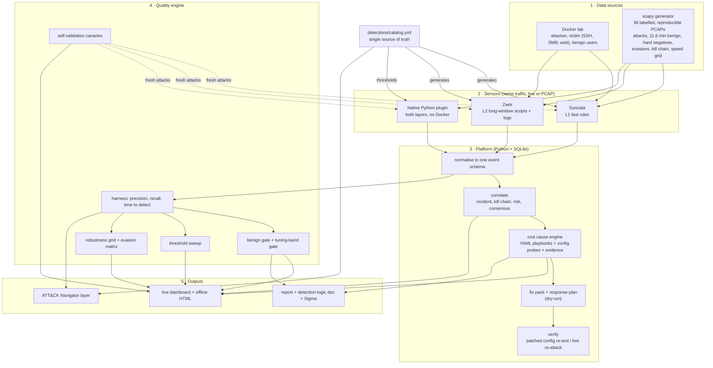

# Architecture

## Diagram

## Flow, step by step

1. **Catalog.** `detections/catalog.yml` defines each attack class: ATT&CK technique, thresholds for two layers, severity, D3FEND and mitigations. `python -m tripwire build-rules` renders the Suricata rules and the Zeek script from it. Nothing downstream is hand-copied, so nothing drifts.
2. **Traffic.** Two sources feed the same pipeline. The Docker lab produces authentic captures. The scapy generator produces reproducible, labelled captures where ground truth is known by construction (who attacked, when, what class), including benign traffic, hard negatives, evasions and a speed grid.
3. **Sensors.** Suricata runs L1: short windows, instant. Zeek runs L2: five-minute windows that catch slow and low attacks, and writes the protocol logs used as evidence. A native Python plugin implements both layers without Docker and doubles as the engine behind the threshold sweep.
4. **Normalise.** Every alert from every sensor becomes one event: time, sensor, layer, class, attacker, victim, port, technique, tactic, severity.
5. **Correlate.** Alerts from one source become one incident. Stages are ordered along the kill chain (recon, discovery, credential access, lateral movement). Risk (0 to 10) rises with extra stages, kill-chain order and two-sensor consensus.
6. **Root cause.** For each stage a YAML playbook lists hypotheses ("SSH password authentication is enabled"). Each has tests against the victim's real config files and against network evidence (Zeek logs, or the PCAP). A cause is confirmed when its tests agree; confidence rises with independent agreeing tests. Impact is assessed too (did the attacker get in?).
7. **Fix.** Each confirmed cause carries an immediate, short-term and long-term fix, an ATT&CK mitigation and a config patch. The patches become a fix pack with a unified diff.
8. **Verify.** Patches are applied to a copy of the configs and every config test is re-run (cleared or still failing). `lab/verify.sh` re-runs the real attacks against the patched lab for network-evidence causes.
9. **Respond.** A dry-run plan of nftables block rules, never touching the management subnet or the victim. `--enforce` is explicit opt-in and lab only.
10. **Quality.** The harness scores every sensor against ground truth. The gate fails the run on any alert on benign or hard-negative traffic, on any missed attack class, or on a threshold outside its measured safe band. The sweep, robustness grid and evasion matrix explain the numbers. Canaries generate fresh randomised attacks so a silently broken detection is caught.
11. **Outputs.** Live dashboard (stdlib HTTP server, SQLite store, no external services), an offline HTML copy, the Navigator layer, the results report and the detection-logic document.

## Design decisions

- **Two layers, not one rule.** A single threshold forces a trade-off between catching slow attacks and avoiding false positives. Two windows remove the trade-off.
- **Measured thresholds.** The sweep computes the safe band from labelled data. A threshold is a result, not a guess.
- **Deterministic root cause.** Explainable, auditable and offline. An LLM is deliberately not part of the decision.
- **Dry-run by default.** Automated response is opt-in, allowlisted and limited to the lab.
- **Graceful degradation.** No Docker: the native engine runs everything. No Zeek logs: evidence comes from the PCAP and the report says so.
- **Live and replay share one code path.** `serve --tail` follows sensor logs; `serve` (replay) streams a finished run at an accelerated clock. Downstream behavior is identical, so the demo does not depend on live capture working on a laptop.
